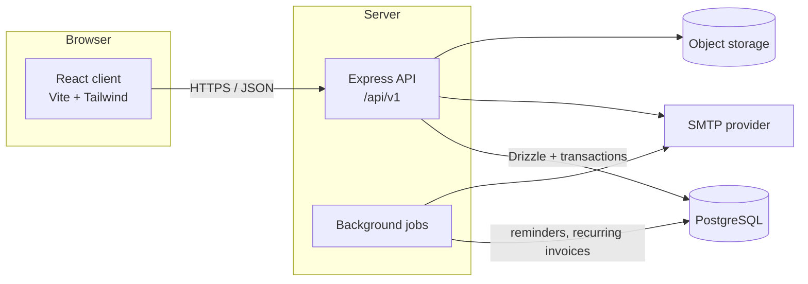
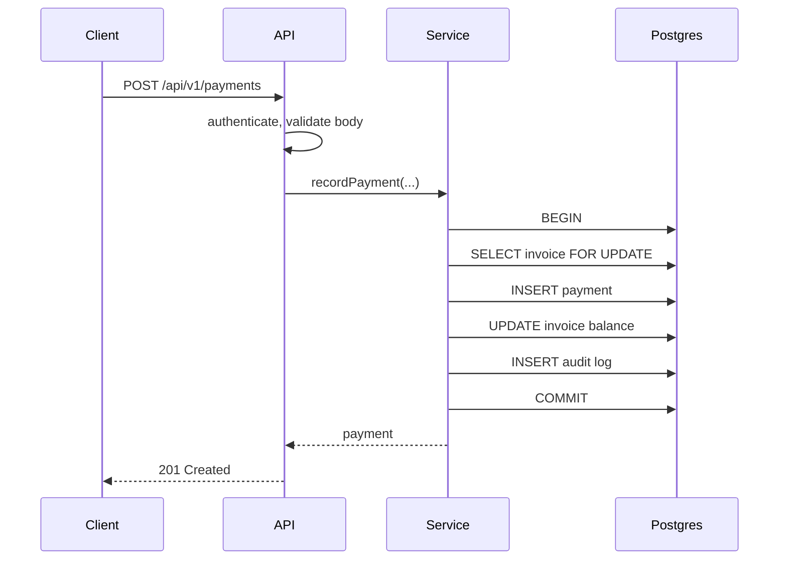

# Architecture overview

GoFlow is a two-application monorepo built around a relational core.



## Layers in the API

| Layer      | Responsibility                              |
| ---------- | ------------------------------------------- |
| Route      | Path and HTTP method, middleware wiring     |
| Controller | Request parsing, shaping the response       |
| Service    | Business rules, authorisation, transactions |
| Repository | SQL through Drizzle, no business rules      |
| Domain     | Pure functions: money, tax, status, dates   |

Rules that keep the boundaries honest:

- Controllers never touch the database directly.
- Services never read `req` or write `res`.
- Repositories never decide policy (no "if the user is an admin…").
- Anything financial that can be computed without I/O lives in a pure module and
  is unit-tested exhaustively.

## Request lifecycle



## Workspace isolation

Every business record belongs to a workspace. The authenticated user's workspace
membership is resolved once per request, and repositories always scope by
`workspace_id`. A record from another workspace is indistinguishable from a
missing record: the API returns `404`, never `403`.

## Error contract

All errors share one envelope:

```json
{ "error": { "code": "INVOICE_NOT_FOUND", "message": "Invoice not found." } }
```

Internal details are never returned in production responses.

## Related decisions

- [ADR-001](adr/ADR-001-project-architecture.md) — monorepo layout
- [ADR-002](adr/ADR-002-database-and-orm.md) — PostgreSQL and Drizzle
- [ADR-003](adr/ADR-003-money-representation.md) — integer minor units
